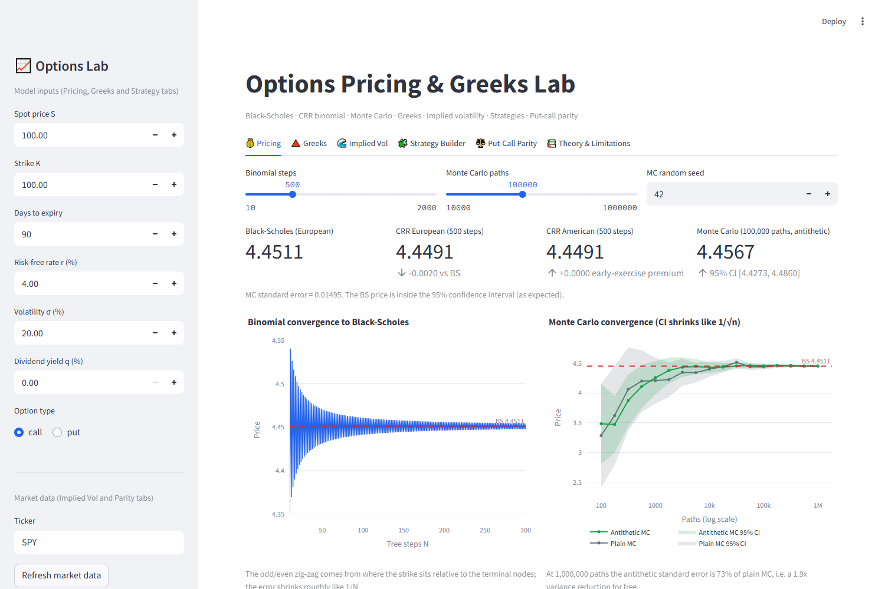
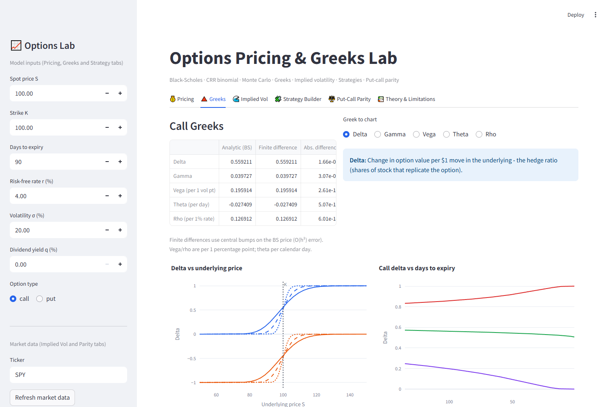
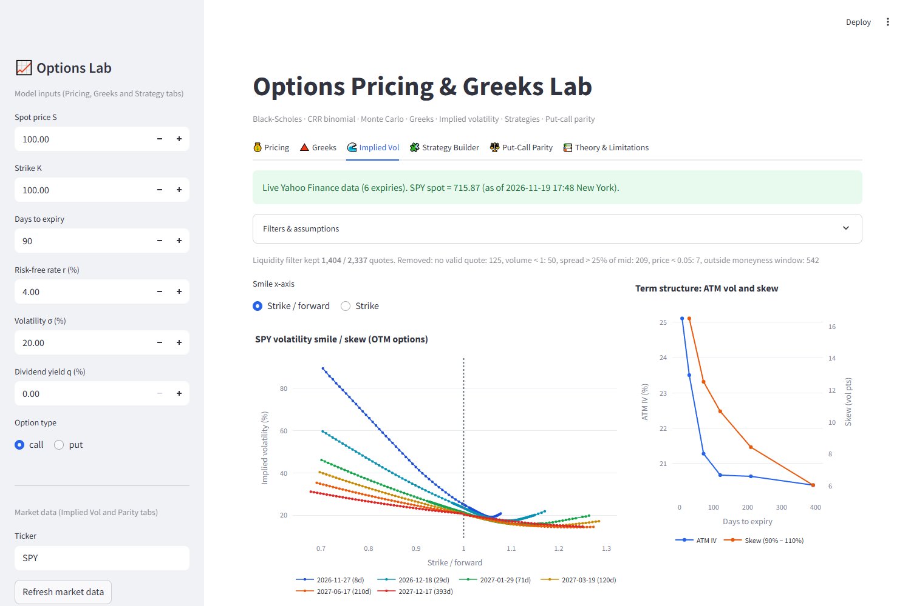
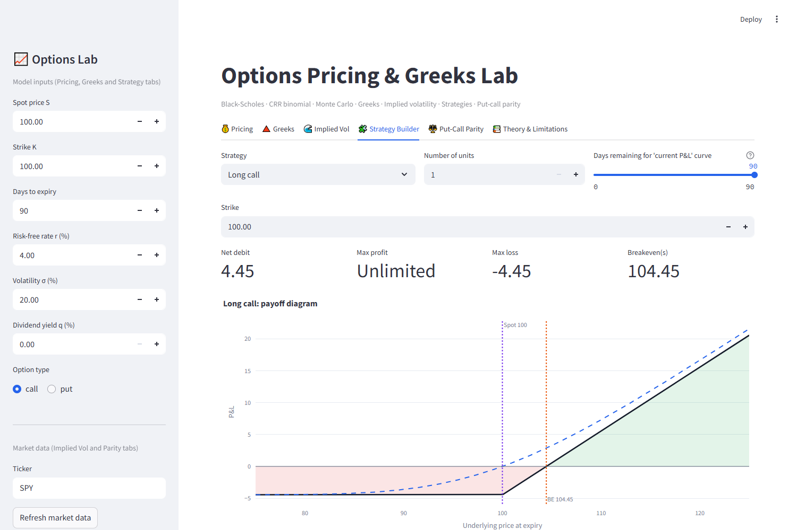
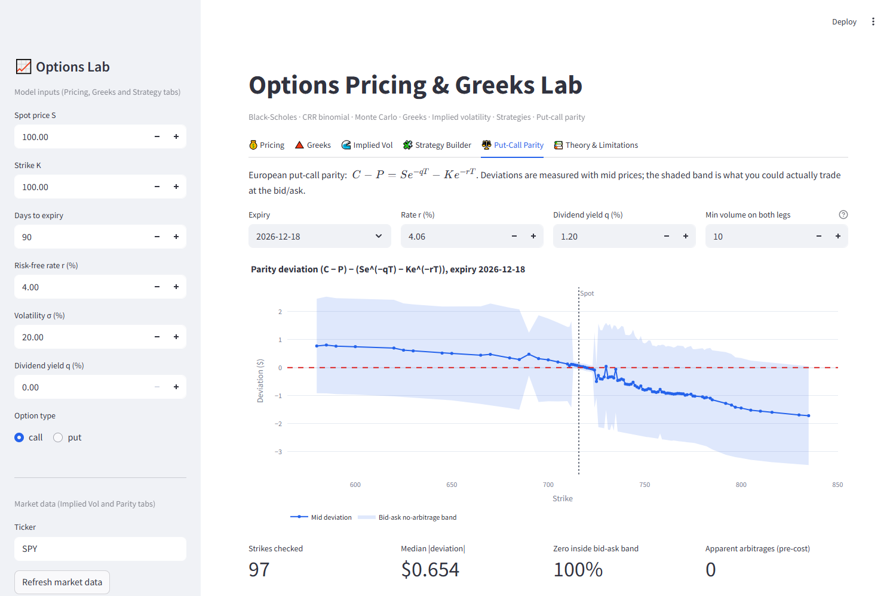
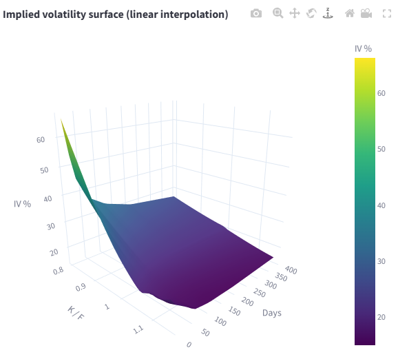

# Options Pricing & Greeks Lab

An interactive Streamlit app that prices European and American options with three models, computes and
verifies the Greeks, extracts implied volatility from **live option chains**, builds option strategies and
tests put-call parity on real market data.

**Live demo:** _add your Streamlit Community Cloud URL here_



## Features

| Tab | What it does |
|---|---|
| **Pricing** | Black-Scholes (closed form), Cox-Ross-Rubinstein binomial tree (European **and American**), Monte Carlo with antithetic variates and a 95% confidence interval, side by side. Convergence charts for tree steps and MC paths against the BS price. |
| **Greeks** | Delta, gamma, vega, theta and rho from the analytic BS formulas, each checked against central finite differences. Charts of each Greek against the underlying price and against time to expiry. |
| **Implied Vol** | Safeguarded Newton-Raphson IV solver with bisection fallback. Pulls live chains with `yfinance` (default **SPY**, any ticker), filters illiquid strikes, and plots the smile/skew, the ATM term structure and an IV surface. Our IVs are cross-checked against Yahoo's. Falls back to a built-in synthetic chain if the API fails. |
| **Strategy Builder** | Long call, straddle, strangle, bull call spread, iron condor and covered call. Shows the payoff at expiry, current mark-to-model P&L, **exact** breakevens and max profit/loss, legs and position Greeks. |
| **Put-Call Parity** | Parity deviation per strike on live quotes, with the executable bid-ask band, conversion/reversal edges, and implied forward and dividend yield per expiry. |
| **Theory** | Formulas, assumptions and limitations. |

## Project structure

```
app.py                 Streamlit UI (6 tabs)
src/models/bs.py       Black-Scholes-Merton pricing (vectorised)
src/models/binomial.py CRR tree, European + American
src/models/monte_carlo.py  GBM Monte Carlo, antithetic variates, CI
src/greeks.py          Analytic Greeks + finite-difference verification
src/iv.py              Implied vol: Newton-Raphson + bisection fallback
src/data.py            yfinance chains, T-bill rate, cleaning, synthetic fallback, implied forward
src/strategies.py      Legs, strategy presets, exact breakeven / max P&L analytics
src/analysis.py        Smile/skew tables, IV surface grid, parity diagnostics
tests/                 pytest suite (208 tests)
```

## Run locally

```bash
pip install -r requirements-dev.txt
pytest                 # 208 passed
streamlit run app.py
```

## Deploy to Streamlit Community Cloud

1. Push this folder to a public GitHub repository.
2. At [share.streamlit.io](https://share.streamlit.io) choose **New app**, pick the repo, branch, and `app.py`.
3. Under *Advanced settings* select Python 3.12 or 3.13.

No secrets, API keys or local file paths are needed. Market data comes from Yahoo Finance at runtime and is
cached for 15 minutes. If Yahoo is unreachable (it sometimes rate-limits cloud IPs), the app switches to a
synthetic sample chain and says so in a banner.

## The maths

**Black-Scholes-Merton** (continuous dividend yield *q*)

$$C = Se^{-qT}N(d_1) - Ke^{-rT}N(d_2),\qquad P = Ke^{-rT}N(-d_2) - Se^{-qT}N(-d_1)$$
$$d_1 = \frac{\ln(S/K) + (r - q + \tfrac12\sigma^2)T}{\sigma\sqrt T},\qquad d_2 = d_1 - \sigma\sqrt T$$

**CRR binomial tree:** $u = e^{\sigma\sqrt{\Delta t}}$, $d = 1/u$, $p = \frac{e^{(r-q)\Delta t} - d}{u - d}$,
$V = e^{-r\Delta t}[pV_u + (1-p)V_d]$, and for American options $V = \max(V, \text{intrinsic})$ at every node.

**Monte Carlo:** $S_T = S\exp\big((r - q - \tfrac12\sigma^2)T + \sigma\sqrt T Z\big)$. Each antithetic pair
$\tfrac12[f(Z) + f(-Z)]$ is one i.i.d. sample. $\text{SE} = s/\sqrt n$ and the CI is $\hat V \pm 1.96\,\text{SE}$.

**Greeks**

| | Call | Put |
|---|---|---|
| Δ | $e^{-qT}N(d_1)$ | $e^{-qT}(N(d_1) - 1)$ |
| Γ | $e^{-qT}n(d_1) / (S\sigma\sqrt T)$ | same |
| Vega | $Se^{-qT}n(d_1)\sqrt T$ | same |
| Θ | $-\frac{Se^{-qT}n(d_1)\sigma}{2\sqrt T} - rKe^{-rT}N(d_2) + qSe^{-qT}N(d_1)$ | $-\frac{Se^{-qT}n(d_1)\sigma}{2\sqrt T} + rKe^{-rT}N(-d_2) - qSe^{-qT}N(-d_1)$ |
| ρ | $KTe^{-rT}N(d_2)$ | $-KTe^{-rT}N(-d_2)$ |

The app shows vega and rho per 1 percentage point and theta per calendar day. The tests check the BS PDE
$\Theta + \tfrac12\sigma^2S^2\Gamma + (r-q)S\Delta - rV = 0$ to $10^{-10}$.

**Implied volatility:** $\sigma_{n+1} = \sigma_n - (BS(\sigma_n) - P_{mkt})/\text{vega}$, kept inside a bracket
that shrinks every iteration. A bisection step is used whenever Newton would leave the bracket or vega is
tiny. Prices outside the no-arbitrage bounds return no vol instead of a made-up number.

**Put-call parity:** $C - P = Se^{-qT} - Ke^{-rT}$. The implied forward is $F = K + e^{rT}(C - P)$, and the implied yield is $q = r - \ln(F/S)/T$.

## Validation

| Check | Result |
|---|---|
| Hull Ex. 15.6 (S=42, K=40, T=0.5, r=10%, σ=20%) | Call 4.7594, put 0.8086 ✔ |
| Hull Greeks example (S=49, K=50, T=0.3846, r=5%, σ=20%) | Δ 0.522, Γ 0.066, ν 12.1, Θ −4.31/yr, ρ 8.91 ✔ |
| Hull Fig. 21.4 American put, 5-step tree | 4.49 ✔ (converges to ≈ 4.28 at 2000 steps) |
| Analytic vs finite-difference Greeks | Agree to ~1e-6 relative |
| CRR → BS | Error < 0.005 at 1000 steps |
| MC antithetic vs plain (200k paths) | SE 0.0055 vs 0.0111 on the Hull ITM call, a **4× variance reduction** (about 2× for an ATM call, see the app) |
| IV round trip | 160 parametrised cases (σ 8%–150%, T 1 week–3 years, deep ITM/OTM) recover σ to 1e-5 |

## Findings from live SPY data (snapshot 19 Nov 2026, spot $715.87, 13-week T-bill 4.06%)

**1. A pronounced put skew that steepens at short maturities.**

| Expiry | ATM IV | IV @ 90% K/F | IV @ 110% K/F | Skew (90−110) |
|---|---|---|---|---|
| 8 days | 25.1% | 42.7% | (no quotes) | — |
| 29 days | 23.5% | 34.0% | 17.5% | 16.5 pts |
| 71 days | 21.3% | 28.5% | 16.0% | 12.5 pts |
| 120 days | 20.7% | 26.4% | 15.8% | 10.7 pts |
| 210 days | 20.6% | 24.6% | 16.2% | 8.4 pts |
| 393 days | 20.4% | 23.3% | 17.2% | 6.1 pts |

OTM puts are much more expensive in vol terms than OTM calls. This is the post-1987 "crash premium":
investors buy downside protection, dealers who are short that protection need paying for the gap risk, and
equity returns really are negatively skewed (vol rises as prices fall, the *leverage effect*). In
risk-neutral terms, the market's distribution has a much fatter left tail than the lognormal one
Black-Scholes assumes. The skew is steepest for short expiries because a sudden gap down is large relative
to the small diffusion possible in a few days. A slight upturn at high strikes (a "smirk") appears in the
short expiries.

**2. Inverted ATM term structure.** Short-dated ATM vol (25.1% at 8 days) is above long-dated vol (20.4% at
1 year). In calm markets the curve usually slopes upward, so an inversion means the market is pricing
near-term stress or event risk.

**3. Put-call parity holds inside the bid-ask spread, and the deviations have identifiable causes.** With
both legs traded at least 10 times, zero lies inside the executable bid-ask band for **100%** of strikes in
the 29-day expiry. No arbitrage survives transaction costs. The systematic deviations are informative:
- A **flat offset of about +$0.85 across all strikes** in the 1-week expiry. The option quotes reflect a SPY
  price about $1.3 away from the last close used as spot. Spot and quotes are not synchronous, which is why
  the IV tab backs the forward out of parity by default.
- At high strikes the deviation turns **negative and grows with maturity** (−$1.4 at 1 month, −$3.8 at
  4 months, −$5.6 at 7 months). This is the **early-exercise premium of deep-ITM American puts**. SPY options
  are American, so $P$ is worth more than the European formula and $C - P$ falls short.
- The implied dividend yield from near-ATM parity is about 0.5–1.1%, below SPY's trailing yield of ~1.2%. This
  is consistent with the options market's financing rate (as seen in box spreads) sitting above T-bills.
- Strikes where one leg barely traded showed apparent "arbitrages" of $15–45. They are stale quotes, which is
  why the checker has a minimum-volume filter.

**4. Our IVs match Yahoo's to a median of about 1.2 vol points** on OTM quotes. The differences come from
Yahoo's own rate, dividend and timing assumptions.

_These numbers come from one snapshot and will differ when you run the app._

## Screenshots

| | |
|---|---|
|  |  |
|  |  |



## Limitations

- **Constant-vol models.** BS, CRR and MC all assume one σ, which the smile contradicts. Natural extensions are
  local vol (Dupire), stochastic vol (Heston) or SABR, and an arbitrage-free SVI fit for the surface.
- **American vs European.** IVs on live data are computed with the European BS formula, while SPY and
  single-stock options are American. The error is small near the money but material for deep-ITM puts (one
  reason to use OTM options for the smile). Pricing with the CRR tree would remove it at a higher compute cost.
- **Dividends and rates.** A continuous dividend yield and a flat T-bill rate replace a discrete dividend
  schedule and a proper discount curve such as SOFR.
- **Data quality.** Yahoo Finance data is delayed, unofficial, sometimes stale and can be rate-limited. Spot and
  option quotes are not synchronous. Outside market hours bid/ask can be zero (there is an option to use last
  prices instead).
- **Surface.** Linear interpolation of raw quotes, with no smoothing and no calendar or butterfly arbitrage
  checks.
- **Monte Carlo** is limited to European payoffs. It is there to show the method, its convergence and
  variance reduction, not because a vanilla option needs it.
- **Transaction costs** (stock spread, borrow fees, margin) are left out of the parity edge calculations.
